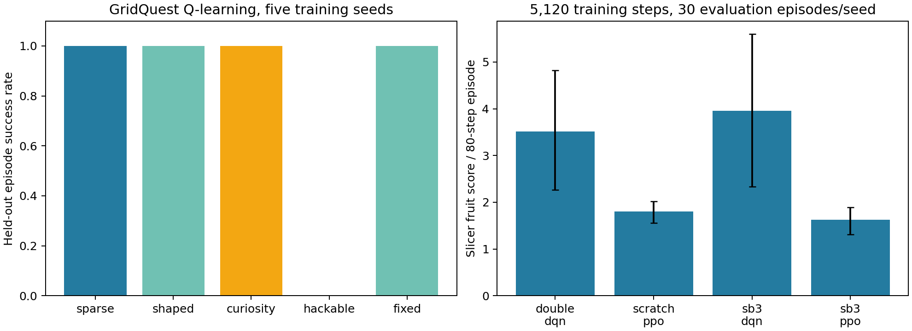

# PlaytestRL

PlaytestRL uses two small Gymnasium games to ask how an automated player learns and whether it can expose a broken game rule. GridQuest makes reward-design mistakes visible; Slicer supports a bounded comparison of hand-written and library agents. A separate playtest harness measures how four search policies find five planted defects, one of which the original bug oracle was not written around.



## Why this project

Manual game testing can miss paths that nobody thought to script. An agent may reach those paths, but it may also learn to farm a badly designed reward. The games and injected defects here are small enough to inspect, so both successes and failures have an explanation.

## Current milestones

| Area | What works today | Next question |
|---|---|---|
| Games and agents | Checked GridQuest/Slicer environments, tabular Q-learning, scratch Double DQN/PPO and library references | Trained on the default Slicer, neither the scratch Double DQN and PPO nor the SB3 references showed a measurable transfer loss on seven predeclared held-out bomb-share and speed settings; would longer budgets on the bomb-heavy settings, more seeds or held-out GridQuest layouts change that? |
| Reward and bug studies | A reward-farming counterexample and a contract oracle for four planted defects, also evaluated on eight predeclared held-out maps with moved defects. A fifth defect, a coin taken but never scored, was missed by the original contract in 0 of 180 hunts; a full-state contract written afterwards caught it with no false alarms in 360 clean hunts | Would an oracle frozen before a defect is designed catch it blind? |
| Training evidence | Separate five-seed 5,120- and 10,240-step endpoints, and five-seed 20,480-step checkpoint curves for scratch Double DQN and PPO and for the SB3 references, with exploration tied to absolute steps and a predeclared threshold | Neither PPO converged within 20,480 steps; SB3 and scratch agents ended with no measurable difference |

## Run locally

You need Python 3.12.

```sh
python3.12 -m venv .venv
. .venv/bin/activate
pip install -r requirements.txt
make test
make all
```

`make all` runs the Q-learning, neural, playtest, ablation, and figure pipelines. [Results](RESULTS.md) reports the seeded outcomes and what each metric means.

A separate [10,240-step neural run](evidence/neural_10240.json) doubles the earlier interaction budget for the same four agent families and five seed numbers. It starts fresh models and retains every seed row. The DQN endpoints improved in this small game, but exploration schedules also scale with the chosen budget, so these two runs do not form a checkpoint learning curve. The exact scores and intervals are in [Results](RESULTS.md).

`make curve` trains one Double DQN and one PPO model per seed for 20,480 steps and evaluates the same evolving model every 1,024 steps; `make curve-figure` draws [the curve](figures/learning_curve.png) from the committed [evidence](evidence/learning_curve_20480.json). Its 5,120-step checkpoints reproduce the original endpoint run exactly.

`make difficulty` runs the Slicer difficulty protocol frozen in [a protocol file](evidence/slicer_difficulty_protocol.json) before any result existed. Scratch Double DQN and PPO are trained on the default game with the curve settings (five seeds, 20,480 steps) and evaluated unchanged on seven held-out bomb-share and speed settings, against fresh agents trained on each setting and random and scripted anchors. No agent showed a measurable transfer loss. DQN's apparent fruit-score gains on the bomb-heavy settings came with more bomb hits, and PPO was barely above random everywhere ([figure](figures/slicer_difficulty.png), [evidence](evidence/slicer_difficulty_20480.json)). The default-setting models reproduce the committed curve checkpoints 210 of 210.

`make sb3` applies the same protocol design to the Stable-Baselines3 DQN and PPO references under [their own frozen protocol](evidence/sb3_reference_protocol.json). A callback checkpoints each model every 1,024 steps up to 20,480. SB3 DQN reached the predeclared threshold in 5 of 5 seeds and SB3 PPO in none; every comparison with the scratch agents read "no measurable difference", and no SB3 agent showed a transfer loss on the held-out settings ([evidence](evidence/sb3_reference_20480.json)).

`make defect` hunts a fifth defect, `coin_not_scored`, under [a protocol frozen first](evidence/new_defect_protocol.json) on the default map and the eight held-out maps. The original contract never saw it (0/180). A full-state contract that predicts position, key, coin and score after every move caught it in every random and coverage hunt, 21 of 40 held-out count-bonus hunts and 5 of 40 scripted hunts, with no false alarm in 360 clean hunts. That contract was written knowing the defect, so this is a fix, not a blind test ([evidence](evidence/new_defect_results.json)).

`make unseen-protocol` freezes eight seeded held-out GridQuest maps (each with its own key, door, goal, walls and traps), plus the policies, seeds and metrics, in [a protocol file](evidence/unseen_levels_protocol.json), and refuses to overwrite it. `make unseen` refuses to run if the regenerated maps differ, then hunts every defect with every policy on every map and on clean copies. All four policies raised zero false alarms on the clean maps. Detection carried over for the random and coverage policies but fell for the count-bonus policy ([results](evidence/unseen_levels_results.json)).

The playtest comparison now stops when observed movement or score breaks the game's declared rules, without reading the injected defect label. A regression test also fixed the score-overflow scenario so it happens on a repeat coin visit, as intended. The [new 80-run evidence](evidence/playtest_contract_oracle.json) is separate from the earlier labeled-fixture experiment; [Results](RESULTS.md#contract-based-playtesting-18-october-2026) gives both tables and explains the change. The oracle still knows this small game's map and score bound, so unseen-game detection is open.

## Repository map

`envs/` defines the games; `agents/` implements the policies; `playtest/` injects defects; `evidence/` and `figures/` hold seeded outputs.

## Scope

The environments and bug set are authored fixtures. Detection rates here do not estimate performance on commercial games. The comparison figure shows evaluation endpoints, and the 10,240-step run started fresh agents; the separate checkpoint-curve figure is the learning curve. The held-out maps are generated variations of one small game.
